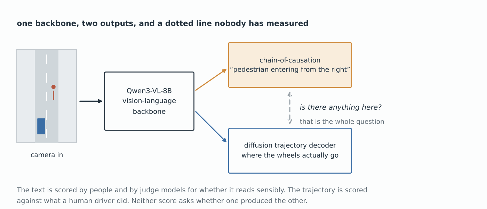
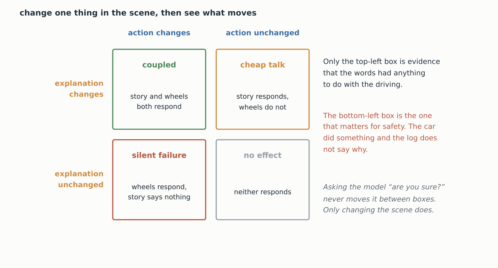
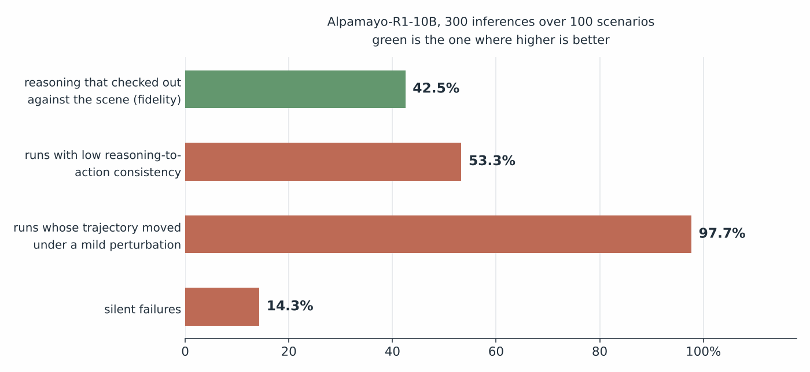

*On the cover: the same junction twice, once with a pedestrian and once without, and the same sentence underneath both. Source: Author.*

In [the VLA post](/blog/vla-pixels-to-tokens/) back in January we gave the language model hands, and then we put it in a car. The last thing that post said about driving was about structured causal reasoning, the kind where the model writes down why it is braking before it brakes. That was the field's bet on getting the benefit of grounding without burning the latency budget.

So the model now tells you why. "Pedestrian entering the carriageway from the right, reducing speed." Lovely sentence. Legible, auditable, the sort of thing you could put in front of a regulator.

Then somebody covered ten percent of the camera frame with a grey rectangle. The car picked a different trajectory. The sentence came out word for word the same.

Welcome to the era of **faithfulness testing**. This is the story of how you find out whether a model's explanation had anything to do with what it actually did, and of why asking the model nicely is the one method guaranteed not to work.

## What the witness says

Start with what is being tested. [Alpamayo-R1](https://arxiv.org/abs/2511.00088) (NVIDIA, 2025) is a driving VLA built the way most of them now are (Alpamayo is a mountain in Peru, and NVIDIA has not said why). A vision-language backbone, in this case Qwen3-VL-8B, reads the camera feed. Out of that one backbone come two things. One is a short written chain of reasoning, which the authors call **chain-of-causation**. The other is a trajectory from a diffusion decoder, and that is the part wired to the wheels.

 *Figure 1: the architecture, and the one connection nobody measures. Source: Author*

Look at how those two outputs get graded. The sentence is scored on whether it reads sensibly, by people and increasingly by judge models. The trajectory is scored against what a human driver did in the same place. Both scores can be excellent at once. Neither of them asks the only question an accident investigator would care about, which is whether the first thing caused the second.

That gap has a name borrowed from interpretability work on language models. An explanation is **plausible** if a person reading it nods. It is **faithful** if it is actually why the system did the thing. The two come apart, and they come apart worst where the writing is most fluent.

The same question has been circling [chain-of-thought](/blog/test-time-compute/) in text models for a couple of years. A driving model just makes the stakes legible, because the trajectory is a number you can check for movement.

## Why "are you sure?" is not a question

Here is the trap. You cannot test faithfulness by interrogating the model, and the reason is a bit more interesting than it first looks.

Ask it "are you sure you braked for the pedestrian?" and it will say yes, at length, with supporting detail. Ask it "did you actually see the pedestrian?" and it will say yes to that too. The thing generating the answer is the same thing that generated the explanation, so you are asking the witness to vouch for his own testimony. A barrister would not bother. What a barrister does instead is change one fact and watch what happens to the story.

That is a counterfactual, and it is the whole method. Take a scenario, record the explanation and the trajectory. Then intervene on the scene: remove the pedestrian, blur the frame, occlude a corner. Run it again and compare both outputs against the originals.

 *Figure 2: four things that can happen when you change the scene, and only one of them is good news. Source: Author*

Four things can happen and they are not equally interesting. If both outputs move, the words and the wheels are at least responding to the same world. If only the words move, the explanation is weather commentary. If only the trajectory moves, you have a car that changed its mind and did not say so, which the paper calls a **silent failure** and which is the one that should keep you up.

The formal version, which [the paper](https://arxiv.org/abs/2605.17268) frames in terms of mutual information, is a sufficiency condition. In words, if the reasoning really is the reason, then once you have read the reasoning, looking at the scene should tell you nothing further about where the car is going to go. Specifically,

$$I(T\,;X \mid R) = 0$$

where $T$ is the trajectory, $X$ is the scene the cameras saw, $R$ is the written reasoning, and $I(\cdot\,;\cdot \mid \cdot)$ is conditional mutual information, meaning how much knowing one thing still tells you about another once you already know the third. Any information about the trajectory that survives in the scene after you have read the explanation, is information the explanation left out.

## Your witness

So, the cross-examination. **Is VLA Reasoning Faithful?** (Mayumu, Deng and Mukala, CVPR 2026 DriveX workshop) ran 300 inferences from Alpamayo-R1-10B over 100 scenarios from the PhysicalAI-AV set, with perturbations as mild as Gaussian blur and ten percent occlusion.

 *Figure 3: what the witness said, scored. Source: Author*

| What they measured | Result | Verdict |
|---|---|---|
| Fidelity: did the reasoning check out against the scene | 42.5% | a coin flip, slightly weighted against |
| Runs with low reasoning-to-action consistency | 53.3% | over half the time the two outputs disagree |
| Trajectory moved under a mild perturbation | 97.7% | the driving is extremely sensitive to the image |
| Silent failures | 14.3% | one run in seven changed course without saying so |
| Pedestrians present and never mentioned | 94 | across those 300 runs |

Walk one scenario through by hand. A pedestrian steps off the kerb on the right. The model writes "pedestrian entering the carriageway from the right, reducing speed", and the trajectory slows. As far as either score can tell, that is a perfect run. Now grey out ten percent of the frame somewhere well away from the pedestrian, and go again. The trajectory comes back different, because 97.7% of the time it does. So check the sentence. If the sentence is unchanged, then whatever moved the wheels was not the thing the sentence described, and you have caught a silent failure without ever having to know what the right answer was.

Read the third and first rows of that table together, because that is where the argument lives. The trajectory responds to almost any change in the image, which means the driving half is paying close attention. The reasoning checks out against the scene in fewer than half the runs. So the pixels are reaching the wheels, and the words are coming from somewhere with a looser connection to the pixels.

97.7%. Not "most runs". Ninety-seven point seven, and it is the one number in the paper that is nearly 100% while being the one you would want near zero.

And 94 pedestrians. That is not an abstract metric. Ninety-four times, a person was standing in the scene and the written reasoning did not mention them. And the written reasoning is the auditable artefact here, the thing you would hand an investigator. The car may well have braked. The log just has nothing in it about why.

The model is not lying, by the way. Lying takes knowing the truth and choosing something else, and this thing has never held a belief in its life. It is producing the most plausible sentence for a scene that looks like this one. That is exactly what it was trained to do. It is also exactly what nobody should have mistaken for an account of its own behaviour.

## Four more in the box

One model and one workshop paper is an anecdote. A second group ran [intervention-based counterfactuals](https://arxiv.org/abs/2610.30953) across four different driving VLAs and landed in the same place. Reasoning can be plausible and it can visibly respond to what is on the screen. That still does not make it a faithful account of why the model drove as it did.

The method generalises past driving, too. [Explanation-driven counterfactual testing](https://arxiv.org/abs/2510.00047) does the same thing to ordinary [vision-language models](/blog/vlm-pixels-to-tokens/): take the concepts the model cited in its answer, edit exactly those out of the image, and see whether the answer follows. If a model says it identified the bird by its red crest and you paint the crest grey and the answer does not budge, the crest was decoration.

Every system that puts a reason next to a decision has this same shape, and that is now most of them.

## Where things are going

- **Training against the counterfactual, not just testing with it.** [CF-VLA](https://arxiv.org/abs/2512.24426) mines the scenes where a base model's rollouts are most informative, labels counterfactual reasoning traces for them, and trains on those. It reports up to 17.6% better trajectory accuracy and 20.5% on safety metrics.
- **Faithfulness as a reward.** Another group trains [a critic](https://arxiv.org/abs/2607.04681) to score whether an embodied model's words match its actions, then uses that critic as the reward signal, and reports 1.6× the responsiveness to rare counterfactual scenarios of the policy it started from.
- **Logs that mean something.** If a written reason is going into an incident report, somebody will eventually have to certify that the reason is the reason. The counterfactual test is the only candidate procedure anyone has.
- **The same audit, pointed at agents.** A coding agent that explains a refactor has the identical structure: one model, two outputs, no measured link between them.

## What cross-examination cannot establish

The headline evidence is 300 inferences over 100 scenarios of one model, in a workshop paper. That is a careful probe, not a survey, and the authors present it as one. And [benchmarking in this field](/blog/llm-benchmarks-terminal-bench/) was already a mess before anybody started scoring explanations as well as actions.

The perturbation result is the shakiest of the lot, and it is the most quoted. Gaussian blur and ten percent occlusion do not only test the reasoning, they degrade the perception. A trajectory that changes under a blurrier image might be a model correctly responding to a genuinely worse view of the road. Calling 97.7% "fragility" treats a possibly sensible reaction as a defect, and separating the two would need perturbations that leave the scene's meaning intact. Changing a parked car's colour is such a perturbation. Blurring the whole frame is not.

"Fidelity" is also a scored judgement rather than a measurement. Somebody, or some judge model, decided whether a sentence checked out against a scene, and 42.5% is as good as those criteria are. I cannot check the criteria from here, and neither can you without the appendix.

Then the uncomfortable one. Faithfulness is not safety, and the two can trade against each other. A model that drives perfectly and explains itself badly has a documentation problem. A model that drives into a bollard and explains that decision with total fidelity has passed this test. Every number here is about the relationship between two outputs, and the actual question, whether the car stops, is somewhere else.

Last, there is no ground truth to appeal to. We have no way of reading the real reason out of a network, so a counterfactual test measures whether an explanation is *sensitive* to the thing it claims to be about. Sensitivity is evidence. It is not the same as having found the cause, and I have not seen anybody claim a method that is.

## Conclusion

The series has spent three posts giving a Transformer eyes, then a mouth, then hands and a steering wheel. This one is about the first time somebody asked the thing to account for itself and then checked the account.

What comes back is that fluency and causation were never the same wire. The trajectory decoder is reading the road closely enough that a grey rectangle in the corner moves the steering. The sentence is reading the road closely enough to sound right. In 14.3% of runs the two came apart far enough that the car changed course and the log stayed silent about it. That is the number I would put on the first slide of any meeting about explainable autonomy.

My bet is that counterfactual testing ends up in certification paperwork rather than in papers. It is the only audit anybody has that does not consist of asking the system whether it meant it. And the obvious thing to want next is a perturbation set that changes what a scene means without changing how clearly you can see it. Until that exists, every fragility number has an innocent explanation sitting right next to it.

The witness gave a beautiful account. He just gave the same one after we moved the furniture.

And now you know. Fin.
