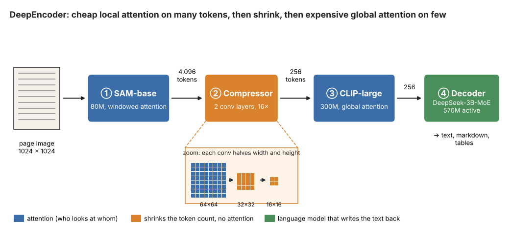
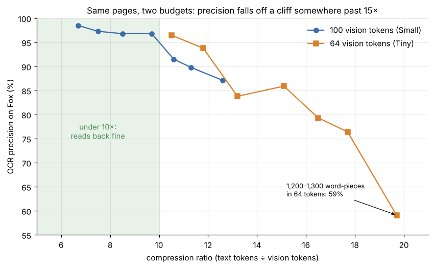
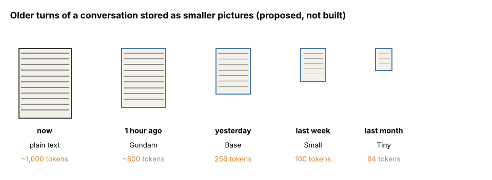

*On the cover: a placeholder drawing of a microfiche, 98 frames at 24 to 1. The machine this was written on could not reach Wikimedia Commons, so a real photograph of a fiche reader still has to go here. Source: Author*

A microfiche is a sheet of film about the size of a postcard, 105 by 148 millimetres. Film a page at a reduction of 24 to 1 and the sheet holds 98 pages in a grid of seven rows and fourteen columns. Push the reduction to 48 to 1 and it holds 270. For about fifty years, this is how libraries kept old newspapers, bank statements and parts catalogues: a filing drawer of postcards instead of a basement of paper.

You cannot read one with your eye, of course. You slide it into a reader, a grey box with a lens and a screen, and crank the stage until the page you want fills the glass.

Now let's hold that next to a language model. It pays for every [token](/blog/tokenizers-bpe/) it reads, and a dense page of English costs about a thousand of them. In October 2025, DeepSeek showed that a *picture* of the same page can go in as 100 tokens, and a small model will read nearly all of the text back out of it. The page shrinks ten times, and the only change is that it was photographed instead of typed.

Welcome to the era of **optical context compression**. This is the story of DeepSeek-OCR, the camera they built to put a page on film, and of how far you can turn the reduction knob before the letters stop coming back.

## Why a long document is expensive

I want you to think about what a model does with a long input. Every token it reads gets compared against every other token, which is what attention is. So the work grows with the square of the length. A 10-page contract at a thousand tokens a page is 10,000 tokens and about $10^8$ pairs. A 100-page contract has ten times the tokens and a hundred times the pairs.

And while the model writes its answer, it keeps a key and a value for every token it has read, which is the [KV cache](/blog/kv-caching-mla-is-attention-all-you-really-need/). That cache sits in GPU memory for the whole conversation, so long chats run out of memory first.

Mathematically, for $n$ tokens the attention work goes as

$$ \text{cost} \propto n^2 $$

where $n$ is the number of tokens in the context. Cut $n$ by ten and the attention bill drops by a hundred. The KV cache is linear in $n$, so it drops by ten. That is why "can I say this in fewer tokens?" is worth a whole paper.

## A picture usually costs more, not less

You might think the obvious fix is to just show the model a photo of the page. Vision-language models have been reading screenshots for a couple of years now. The catch is how they read them.

A [vision transformer](/blog/vit-pixels-to-tokens/) chops an image into square patches, usually 16 by 16 pixels, and every patch becomes one token. A page has to be sharp enough to read, so call it 1024 by 1024 pixels. That gives 64 patches across and 64 down, which is 4,096 tokens. So the photo of a thousand-token page costs four thousand tokens. We have successfully made the problem worse (great job, everyone).

The [VLM post](/blog/vlm-pixels-to-tokens/) went through the usual ways around this. Cutting the image into tiles keeps the detail and multiplies the tokens. Shrinking the image first is fine for a photo of a dog and useless for 9-point type. None of these was built to make the photo *cheaper* than the text. That was the job DeepSeek gave themselves.

## The camera: DeepEncoder

The paper is [DeepSeek-OCR: Contexts Optical Compression, Wei, Sun and Li, 2025](https://arxiv.org/abs/2510.18234). In microfilm terms, it has two halves. There is a camera operator (encoder) who turns a page into a small number of vision tokens, which is our fiche. And there is a reader at the machine (decoder), who looks at the fiche and types the page back out.

The camera is called **DeepEncoder**, and its trick is the order it does things in. It runs three stages in a row:

1. **SAM-base**, 80M parameters. This is the image encoder from Meta's [Segment Anything](https://arxiv.org/abs/2304.02643), a model trained to find the outline of every object in a photo. It takes the 1024-pixel page as 4,096 patch tokens. But most of its attention layers are *windowed*, so each token only looks at its neighbours inside a small square of the page. That keeps the cost close to linear in the token count rather than square. So it is cheap enough to run on all 4,096.
2. **A compressor**, two convolution layers. Each one has a stride of 2, which means it slides a small filter across the grid two cells at a time. So each layer halves the width and halves the height. Two of them take the 64 by 64 grid to 16 by 16, which is 256 tokens.
3. **CLIP-large**, 300M parameters. This is the image encoder from OpenAI's [CLIP](https://arxiv.org/abs/2103.00020), a model trained to match pictures with captions. It uses *global* attention, so every token looks at every other one. That is the expensive kind, and it only ever sees 256 tokens.

 *Figure 1: DeepEncoder and the decoder behind it. Blue boxes are attention, orange shrinks the token count, green writes the text. The zoom is the compressor, which is the whole reason the bill is 256 and not 4,096. Source: Author*

So the cheap local look happens while there are lots of tokens, and the expensive global look happens after there are few. Roughly, the local stage reads the shapes of letters. The global stage works out the layout, like which column a paragraph sits in and where the table starts.

The token count for a square image of side $H$ pixels is then

$$ N_{\text{vision}} = \frac{(H/16)^2}{16} $$

where the 16 inside the bracket is the patch size and the 16 underneath is the compressor. For $H = 1024$ that gives $4096 / 16 = 256$. And where does sixteen come from, by the way? Two convolutions that each halve two sides, so two times two, twice. Nobody had to run an ablation over 15 and 17 to find that one.

## Five lenses on the camera

A fiche reader comes with interchangeable lenses, because a parts catalogue and a broadsheet newspaper do not need the same magnification. DeepSeek-OCR ships with the same idea as a set of named modes:

| Mode | Input size | Vision tokens | What it is good for (per the paper) |
|---|---|---|---|
| Tiny | 512² | 64 | Slides. A few big words a page |
| Small | 640² | 100 | Books and reports at normal type |
| Base | 1024² | 256 | Dense pages and small type |
| Large | 1280² | 400 | Dense pages where Base slips |
| Gundam | n tiles of 640² + one 1024² view | 100n + 256 | Newspapers, which run 4,000 to 5,000 text tokens a page |

Tiny and Small squash the page to a square. Base and Large pad it with blank margins instead, so the letters keep their shape. Gundam is the tiled one: a handful of 640-pixel close-ups for detail and one 1024-pixel view of the whole page for layout. The paper never explains the name. The usual story is the obvious one, that somebody on the team grew up on the giant-robot cartoon, and I am glad nobody in review stopped them.

The last column is the most useful thing in the table. It says the right reduction depends on the document, not on the model. A slide at 64 tokens is plenty. A newspaper at 64 tokens is a grey smudge.

## The reader at the machine

The decoder is **DeepSeek-3B-MoE**, a [mixture-of-experts](/blog/moe-is-attention-all-you-really-need/) language model with about 3 billion parameters in total and about 570M active for each token. It has 64 small expert networks and a router picks six of them for every token, plus two shared experts that always run. So it has the knowledge of a 3B model and the running cost of a 570M one, which is exactly what you want from somebody who will be cranking a fiche reader all day.

It takes the vision tokens in where a normal language model takes word embeddings, and it is trained to write out the page. That can be plain text, or markdown with the headings and tables kept.

The training data is mostly documents. Write-ups of the paper put the main set at about 30 million PDF pages across roughly 100 languages, mostly Chinese and English. On top of that, there are about 10 million charts, 5 million chemical formulas and a million geometry diagrams. That is how the reader learns to turn a bar chart into a table and a drawn molecule into a formula string. Around a fifth of the mix is general image data and a tenth is plain text, so the decoder does not forget how to be a language model.

Training ran on 20 nodes of 8 A100-40G GPUs, 160 cards in all, at about 70 billion tokens a day for image-and-text data. In production, the paper says one A100-40G does more than 200,000 pages a day. That is a bit over two pages a second, around the clock. Or the whole Harry Potter series about once every half hour, if that is your unit (it is mine now).

## How far can you turn the reduction knob?

Here is the experiment the whole paper hangs on. Take English documents from the [Fox benchmark](https://github.com/ucaslcl/Fox), a set of real document pages with known text, and keep the ones that come to 600 to 1,300 text tokens. That is about a hundred pages. Photograph each one at Tiny (64 tokens) and at Small (100 tokens). Ask the decoder to read it back. Then measure how much of the text came out right.

The number on the x-axis is the reduction ratio of our fiche. In words,

$$ \text{compression ratio} = \frac{\text{tokens the page costs as text}}{\text{tokens the page costs as a picture}} $$

specifically,

$$ \rho = \frac{N_{\text{text}}}{N_{\text{vision}}} $$

where $N_{\text{text}}$ counts the page with the decoder's own tokenizer and $N_{\text{vision}}$ is 64 or 100.

| Text tokens on the page | Precision at 100 tokens | Ratio | Precision at 64 tokens | Ratio |
|---|---|---|---|---|
| 600-700 | 98.5% | 6.7× | 96.5% | 10.5× |
| 800-900 | 96.8% | 8.5× | 83.8% | 13.2× |
| 1000-1100 | 91.5% | 10.6× | 79.3% | 16.5× |
| 1200-1300 | 87.1% | 12.6× | 59.1% | 19.7× |

**NOTE:** arXiv is blocked from the machine I write these on. So this table is the paper's Table 2 as I remember it, cross-checked against the rows quoted in write-ups and in a later paper, [Context Cascade Compression](https://arxiv.org/abs/2511.15244). I have dropped three of the seven rows to keep it short. Figure 2 plots all seven.

 *Figure 2: precision against reduction ratio on Fox. Under 10× the reader gets nearly every word. Past 15× it starts making things up, and it does so with complete confidence. Source: Author*

Let's do one page by hand. Say it is a page of a novel that comes to 1,250 text tokens. At Small, it goes on film as 100 tokens, so $\rho = 1250/100 = 12.5$. The reader gets back about 87% of it. On a 1,250-token page that is roughly 160 tokens wrong, so a word or two in every line. Now put the same page through Tiny. It goes on film as 64 tokens, so $\rho = 1250/64 \approx 19.5$. And the reader gets back 59%. That is about 510 tokens wrong, or two lines in every five.

So you saved 36 tokens of film and got about 350 more tokens of the page wrong. That is the ablation, and it is the punchline of the whole paper. The idea holds up to about ten times and gets shaky past fifteen. At twenty, you are reading the 1950s drawer with the wrong lens.

The authors take the 10× line as the real result, since under it precision is about 97%. Is ten times still a lot? Yes, very much so. The paper also runs the full [OmniDocBench](https://github.com/opendatalab/OmniDocBench), a document-parsing benchmark of about a thousand real pages scored by how many edits it takes to fix the output. There, Small at 100 tokens beats [GOT-OCR 2.0](https://arxiv.org/abs/2409.01704), which spends 256 tokens a page. And Gundam, at under 800 tokens, beats [MinerU 2.0](https://github.com/opendatalab/MinerU), a document pipeline that spends more than 6,000. Seven or eight times fewer tokens for a better score is a very good trade.

## Last month's papers go on smaller film

Here is the bit I found most interesting. A library does not keep every newspaper the same way. Today's paper is on the rack at full size. Last year's is on microfilm. The 1950s are on fiche at a reduction so high you need the good lens and some patience.

The paper's discussion section proposes the same thing for a chatbot's memory. The last few turns of a conversation stay as plain text. Older turns get rendered as images and passed through the camera. And the older a turn is, the smaller the image gets, so it costs fewer tokens and blurs a bit more.

 *Figure 3: forgetting by resolution. This is an illustration of the idea in the paper's discussion section, with the time labels mine. DeepSeek did not build or test it. Source: Author*

If you think about it, we humans forget this way too. You remember this morning's meeting word for word, last week's as a gist, and last year's as "there was a meeting". The paper draws exactly that comparison. And Figure 2 says what it would cost: a turn that slides down to Tiny comes back about 60% right, which is a decent gist and a terrible quote.

So this is an idea in a discussion section, with a figure and no experiment. No paper I know of tests whether a model *reasons* well over a conversation stored this way. We only know it can read the words back.

## Where it is used

1. **Making training data.** This is what DeepSeek say they built it for. Twenty nodes do about 33 million pages a day, which is how you turn a pile of scanned PDFs into text for training the next language model.
2. **Document pipelines.** It is an open-weights model that outputs markdown with the tables kept, on one GPU. It replaces a chain of layout detector, text recogniser and table parser.
3. **Long context, by other people.** [Glyph](https://arxiv.org/abs/2510.17800) from Tsinghua and Zhipu came out the same week with the same idea aimed at long inputs: render the text as images and let a vision-language model read them. They report 3 to 4× compression while staying level with text models of the same size on long-context tests.

It loses where the pages are not really pages. Handwriting, a phone photo of a whiteboard at an angle, and a receipt crumpled in a pocket all fall well outside 30 million PDFs.

## Where things are going

The paper's own next step is to train with digital text and optical text mixed together from the start, rather than bolting a camera onto a model that learned language from text. If that works, a model would choose per paragraph whether to read words or pictures.

The other open question is whether the compressed context is any good for *thinking* rather than reading back. The obvious test is a needle-in-a-haystack run, where a single fact is hidden in a long document and the model is asked for it. And the harder one is a question that needs two facts from two different old turns. The paper calls for both and runs neither.

And there is a bigger argument, which Andrej Karpathy made on social media the week the paper came out: maybe every input to a language model should be pixels. The idea is that the tokenizer is an ugly, hand-built step, and a picture of text keeps the bold, the colour and the layout for free. DeepSeek-OCR is the strongest evidence for it so far. The next section is about where it falls down.

## The clerk who guesses

Every microfilm room has a clerk who can read a fiche that is too blurry to read. He knows what the 1962 headline probably said, so he reads it out. And he is right most of the time, so nobody checks.

The decoder is that clerk. [Visual Merit or Linguistic Crutch? A Close Look at DeepSeek-OCR, Liang et al., 2026](https://arxiv.org/abs/2601.03714) scrambles the text on the page before photographing it. First it shuffles words and sentences. Then it replaces the words with random strings of letters, so there is no language left to lean on. On ordinary text, the model scores around 90%. With the meaning taken out, it falls to around 20%, and Tiny mode on random letters lands at 19.84%. Older pipeline OCR systems, the ones that recognise characters one at a time, hold up much better on the same test. So a good part of "97% at 10×" is the language model guessing what an English sentence probably says. That is fine for a novel. It is a problem for a part number, a dosage or a bank account, which is where you most wanted OCR to be right. The same paper also reports the model collapsing completely once a page passes about 10,000 text tokens.

Then there is the word "compression". Ten times fewer tokens is not ten times less information. A text token is one entry from a vocabulary of around a hundred thousand, which is about 17 bits. A vision token is a vector of over a thousand numbers at 16 bits each, so it can carry far more. So the saving is in the number of things attention has to compare, which is real money on a GPU. Whether a picture is a cleverer code for language than text, nobody has shown. Plain gzip gets English down about three times, and nobody calls that a context window.

And the benchmark is reading, not using. Fox and OmniDocBench both ask the model to type the page back out. Neither asks it to answer a question about page 40 using a table on page 12. A clerk who can read a fiche aloud perfectly has still not been tested on whether he understood it.

## Conclusion

Twenty-four to one was a reduction somebody chose because the letters still came back at that size. Libraries bought lenses and readers for it, and they did not go further.

DeepSeek-OCR is the same deal with numbers on it. Windowed attention on 4,096 tokens, two strided convolutions to get to 256, global attention on what is left, and a 570M-active reader that types the page back out. Up to 10× it gives back 97% of the text. At 20× it gives back 59%. And a fair part of what it does give back is a language model that has read a lot of English, guessing what your page probably said.

What I would actually build on is the table of modes rather than the headline ratio. A slide needs 64 tokens and a newspaper needs 800. So the interesting system is the one that picks the lens per page, and per turn of a conversation, instead of one reduction for everything.

And keep the full-size paper for anything you will need to quote. The clerk is good, but he has never once said "I can't read that".

And now you know. Fin.
