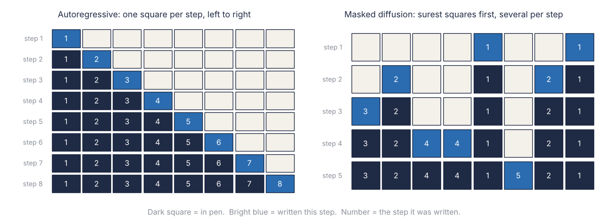
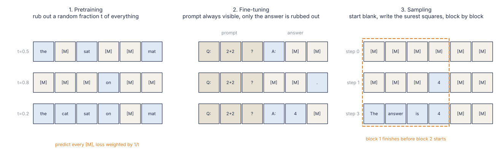
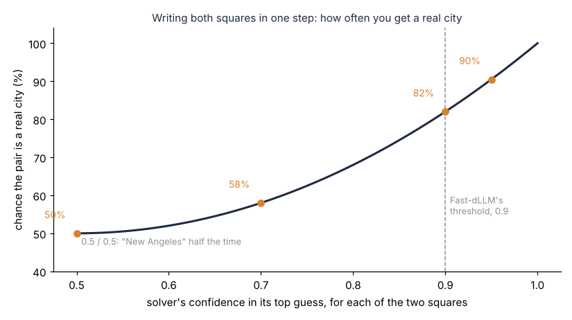
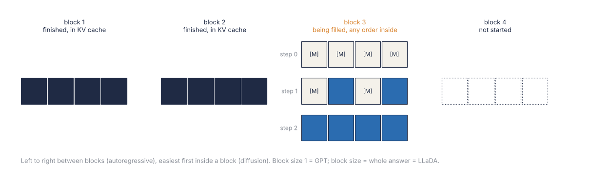

*On the cover: a crossword grid halfway through, with the easy corners already in pen. Placeholder drawn by the author, because Wikimedia Commons could not be reached from the machine this was written on. Source: Author*

In the [Flux posts](/blog/flux-models-next-gen-image-generation-part1/) we watched a picture come out of static. Every pixel starts as noise, and the whole image sharpens together over a few dozen steps. Text never got that treatment. Every language model on this blog since [ChatGPT](/blog/chatgpt-future-of-conversational-ai/) writes left to right, one token at a time, and each token waits for the one before it.

Now hand one of those models a crossword.

It fills 1-across first, then 2-across, then 3-across, strictly in clue order and in pen. 14-down is "cat sound, 4 letters", and it knows the answer cold. But it is not allowed to write MEOW until it has finished 9-across, a seven-letter Elizabethan poet it has never heard of. And when it gets 9-across wrong, it is not allowed to cross anything out.

Welcome to the era of **diffusion language models**. This is the story of what happens when you let a language model look at the whole grid and fill in the easy squares first.

## Why the clue-order solver is slow

An **autoregressive** model (GPT, Llama, Qwen, everything you have used) writes the probability of a sentence as a chain. The first token given the prompt, times the second given the first, times the third given the first two, and so on.

Formally, for an answer $x = (x^1, \dots, x^L)$ of $L$ tokens,

$$
p_\theta(x) = \prod_{i=1}^{L} p_\theta(x^i \mid x^1, \dots, x^{i-1})
$$

where $p_\theta$ is the model with weights $\theta$, and each factor is one forward pass that produces one token.

That chain has two costs, and both come from the order.

The first is speed. Every token needs its own forward pass, and every pass has to read all the weights out of GPU memory. An 8B model in 16-bit is 16 GB of weights. An [H100](https://www.nvidia.com/en-us/data-center/h100/) moves about 3.35 TB a second from memory. So at batch size one, the hard ceiling is around 210 tokens a second. And the arithmetic units spend most of that time waiting (a chip that costs about as much as a small car, mostly reading). The [speculative decoding post](/blog/speculative-decoding/) was one way round this. But there the model still writes left to right, and is just being given hints.

The second cost is stranger. A model that only ever predicts the next token learns facts in one direction. Train it on "Tom Cruise's mother is Mary Lee Pfeiffer" and it can often not tell you whose mother Mary Lee Pfeiffer is. This is the [**reversal curse**](https://arxiv.org/abs/2309.12288) (Berglund et al., 2023). It is the crossword solver who can get 14-down from the clue, but cannot get it from the letters already crossing it.

So the question is, can we train a model that sees the whole grid at once, fills in squares in any order, and fills in more than one per pass?

## A grid full of blanks

Image diffusion, from the [guided diffusion posts](/blog/guided-diffusion-models-part1/), adds Gaussian noise to a clean picture a little at a time, until it is pure static. A network learns to undo one step of that. At generation time you start from static and run it backwards.

You cannot add a little Gaussian noise to the word "cat", though. A token is a whole number, an index into the vocabulary from the [tokenizer post](/blog/tokenizers-bpe/), and 4,872.3 is not a word. So for text, the "noise" has to be discrete. The version that won is the simplest one. Corrupting a token means replacing it with a special blank token, `[MASK]`, and a fully corrupted sentence is all blanks. [D3PM](https://arxiv.org/abs/2107.03006) (Austin et al., 2021) called this the **absorbing state**, because once a token falls into it, it stays there.

So the crossword picture becomes exact:

1. A clean answer is a filled-in grid.
2. The forward process (corruption) rubs out each square independently with probability $t$, where $t$ runs from 0 (nothing rubbed out) to 1 (empty grid).
3. The model (the solver) sees a partly rubbed-out grid and guesses every blank square at once.
4. Generation starts from an empty grid and fills it in over a number of steps.

The solver is a plain Transformer with one change. It has no causal mask, so every position can attend to every other position, left and right. That is the "look at the whole grid" part. And if that sounds a lot like [BERT](https://arxiv.org/abs/1810.04805), it is. BERT rubs out exactly 15% of squares, every time, and learns to fill them back in. A masked diffusion model rubs out a random fraction anywhere from 0% to 100%. So BERT has been a diffusion model with a single noise level since 2018, and nobody told it.

 *Figure 1: The order in which squares get filled. Left, an autoregressive model commits one position per step, in order. Right, a masked diffusion model commits the positions it is most sure of first, sometimes two or three at once. The numbers are the step at which each square went into pen. Source: Author*

### The training loss, in words and then in symbols

Training is the friendliest part. Take a sentence. Pick a rub-out level $t$ at random. Rub out each token with probability $t$. Ask the model to predict the original token at every rubbed-out square, and score it with ordinary [cross entropy](/blog/cross-entropy-loss/). That's it.

In words, the loss is

$$
\frac{1}{\text{fraction rubbed out}} \times \sum_{\text{rubbed-out squares}} \text{how surprised the solver was by the right answer}
$$

specifically, as written in [LLaDA](https://arxiv.org/abs/2502.09992),

$$
\mathcal{L}(\theta) = -\,\mathbb{E}_{t,\,x_0,\,x_t}\left[\frac{1}{t}\sum_{i=1}^{L} \mathbf{1}\left[x_t^i = \texttt{[MASK]}\right]\,\log p_\theta\left(x_0^i \mid x_t\right)\right]
$$

where $x_0$ is the clean sentence, $x_t$ is the same sentence with each token rubbed out with probability $t$, $t$ is drawn uniformly from 0 to 1, and $\mathbf{1}[\cdot]$ is 1 at a blank square and 0 elsewhere. So the sum only counts the squares the solver had to guess.

Where does the $1/t$ come from? At $t = 0.1$ only a tenth of the squares are blank, so the sum is small. At $t = 0.9$ nearly all of them are, so the sum is big. Dividing by $t$ puts every noise level on the same footing. And it is not just a convenience: [MDLM](https://arxiv.org/abs/2406.07524) (Sahoo et al., 2024) showed that with this weight, the loss is an upper bound on the model's negative log-likelihood. That is the same quantity an autoregressive model minimises, so the two can be compared on perplexity. It is also the only place in this post where dividing by a random number is the correct thing to do.

On that comparison, MDLM got diffusion close but not level. On [OpenWebText](https://huggingface.co/datasets/Skylion007/openwebtext) (an open copy of GPT-2's web-scraped training text), it reached a perplexity bound of about 23, against 17.5 for an autoregressive model of the same size (lower is better). The earlier diffusion models, D3PM and [SEDD](https://arxiv.org/abs/2310.16834), had been further behind.

The name, while we are here, is borrowed. Nothing diffuses. "Diffusion" came from physics into image models, where noise spreads like ink in water, and the text models swapped the ink for an eraser.

## Filling the grid

Generation runs the corruption backwards. You decide on an answer length $L$, say 256 tokens, and a number of steps $N$. You start with 256 blanks after the prompt. Then at every step:

1. The solver predicts a token for every blank square, each with a confidence (its probability).
2. You write the most confident ones into the grid, in pen.
3. Everything else goes back to blank, and you run the next step.

With $N = L$ that is one square per step, the same number of passes as an autoregressive model, just in a smarter order. With $N = L/4$ it is four squares per step and four times fewer passes. That is where the speed comes from.

Picking the most confident squares is called **low-confidence remasking**, because what you throw back is the unsure guesses. Let's do one by hand, with made-up numbers (a real model does this over hundreds of positions and a 126,000-token vocabulary). Let's say the prompt is "What is the capital of France? Answer in one sentence." and the grid has six squares. We commit two squares per step.

| Step | Grid after the step | Solver's top guesses (confidence) for the blanks | Why those two |
|---|---|---|---|
| 1 | `_ _ _ _ Paris .` | The (0.55), capital (0.40), of (0.38), France (0.61), Paris (0.93), . (0.97) | The answer and the full stop are what it is surest of, so they go in first |
| 2 | `_ capital _ France Paris .` | The (0.71), capital (0.88), of (0.52), France (0.90) | "Paris" at the end makes "capital" and "France" far more likely |
| 3 | `The capital of France Paris .` | The (0.95), of (0.97) | Only the glue words are left, and now they are easy |

Hmm, that sentence has no verb. The "is" needed a seventh square that the grid never had. I am leaving that in on purpose, because it is the first honest lesson about this method: **the grid size is chosen before you start**, and the solver has to make the answer fit. An autoregressive model just keeps going until it writes the end-of-text token.

Look at step 1 again, though. The solver wrote the answer first and the sentence around it later. A left-to-right model has to commit to "The" before it has decided anything about Paris.

### The punchline: the most confident thing it knows is that the answer ends

Here is the ablation that sold me on this. The [LLaDA](https://arxiv.org/abs/2502.09992) paper (Nie et al., 2025) tried pure low-confidence remasking on its chat-tuned model, on grade school maths word problems ([GSM8K](https://huggingface.co/datasets/openai/gsm8k)). It scored **12.9%**.

Why so bad? During fine-tuning, every short answer was padded out to the full length with end-of-text tokens. So the model learnt that the back half of almost any grid is padding, and it is extremely sure about that. Fill the most confident squares first and it fills the end of the grid with "the end", over and over, and leaves itself almost no room to solve the problem in.

The fix is to solve the grid in blocks. Split the answer into blocks of 32 squares. Fill the first block completely, easiest squares first, before you touch the second one. The paper calls this **semi-autoregressive remasking**, and with it the same model scored **73.8%**. The weights and the number of steps were the same in both runs. Only the order changed.

So the fully free order is not actually what works best. What works is doing the top-left corner of the crossword first, in any order inside that corner, and then moving on.

## LLaDA: the first one big enough to compare

Everything above was known by 2024 at small scale. [LLaDA](https://arxiv.org/abs/2502.09992), from Renmin University and Ant Group in February 2025, was the first serious attempt at 8B:

1. A Transformer with no causal mask, trained from scratch.
2. Pretraining on 2.3 trillion tokens, using exactly the loss above, at a reported cost of 0.13 million H800 GPU hours.
3. Supervised fine-tuning on 4.5 million prompt-answer pairs, where only the answer gets rubbed out and the prompt always stays visible.
4. Sampling with the block-by-block, easiest-first schedule from the last section.

 *Figure 2: LLaDA's three stages. The model is the same bidirectional Transformer in every panel. Only which squares are allowed to be blank changes. Source: Author, redrawn from the description in [LLaDA](https://arxiv.org/abs/2502.09992)*

The headline comparison was against [Llama 3 8B](https://arxiv.org/abs/2407.21783), Meta's autoregressive model of the same size, trained on about 15 trillion tokens. On [MMLU](https://huggingface.co/datasets/cais/mmlu) (a multiple-choice exam across 57 school and university subjects), the base models came in at 65.9% for LLaDA against 65.4% for Llama 3. On GSM8K with four worked examples in the prompt, it was 70.3% against 48.7%. That is on six and a half times less data, which I did not expect.

Then the reversal curse. The authors took 496 pairs of consecutive lines from famous Chinese poems. Given one line, write the next one (forward), or given one line, write the one before it (reversal).

| Model | Forward | Reversal | What it tells you |
|---|---|---|---|
| GPT-4o | 82.7 | 34.3 | Knows the poems well, but mostly in one direction |
| Qwen2.5 7B Instruct | 75.9 | 38.0 | Same shape, smaller |
| LLaDA 8B Instruct | 48.8 | 42.4 | Knows them much less well, and about as well both ways |

The paper's headline is that LLaDA beats GPT-4o on reversal, and it does. But read the forward column too. LLaDA knows these poems far less well than GPT-4o. But it knows them about equally well in both directions, which is exactly what the training predicts. A solver that has seen every square blanked out from every side, has no reason to prefer one side.

## Two squares that disagree

There is a catch in all this, and it sits right where the speed comes from.

When the solver fills several blanks in the same step, it picks each one on its own. It has a confidence for square 3 and a confidence for square 4. It does not have a confidence for the pair. Let's say the prompt is "Name a big American city" and the grid has two squares. The solver thinks:

- square 1: "New" with 0.5, "Los" with 0.5
- square 2: "York" with 0.5, "Angeles" with 0.5

Fill both in the same step and you get "New York" a quarter of the time and "Los Angeles" a quarter of the time. The other half you get "New Angeles" or "Los York" (two cities I would not visit). Fill one square, run the solver again, and the second square sees the first and gets it right every time.

Mathematically, committing several squares at once samples from the product of the one-square guesses, and that is only the same as the real joint guess when the squares do not depend on each other:

$$
p_\theta\left(x^i, x^j \mid x_t\right) \neq p_\theta\left(x^i \mid x_t\right)\,p_\theta\left(x^j \mid x_t\right) \quad \text{in general}
$$

where $x^i$ and $x^j$ are the two squares and $x_t$ is everything filled so far. The training loss never teaches the joint, because it scores every square separately. So more squares per step means faster and, past some point, worse.

 *Figure 3: The two-city example with the confidences turned up. If each square is a fraction $c$ sure of its top guess and the two guesses are picked separately, the pair comes out a real city with probability $c^2 + (1-c)^2$. At 0.5 that is a coin flip. At 0.9 it is 82%. This is for drawing each square at random from its guesses; writing the top guess instead is what makes the threshold rule safe. Source: Author*

The fix that most people use came from [Fast-dLLM](https://arxiv.org/abs/2505.22618) (NVIDIA and collaborators, 2025). Instead of committing a fixed number of squares per step, commit every square whose confidence is above a threshold, say 0.9, and at least one. And it writes each square's top guess rather than a random draw. The paper proves that when every square is that sure, the top guesses written together match what one-at-a-time decoding would have written. If square 1 is 0.9 sure of "New", it has too little probability left for "Los" to change the answer. Easy steps fill many squares and hard steps fill one. A follow-up called dParallel measured this rule on LLaDA-8B-Instruct for GSM8K. It needed 72 steps instead of 256, a 3.6x speedup, at 75.5% against 75.7%.

Fast-dLLM's other fix was a cache. A bidirectional model cannot keep the usual [KV cache](/blog/kv-caching-mla-is-attention-all-you-really-need/), because every square can change every other square. So in principle every step recomputes the whole grid. But a finished block barely changes, so you cache it and refresh once per block. With both tricks the paper reports about 5x to 13x over plain LLaDA. That is a big multiplier on a slow start, because plain LLaDA with no cache is slower than the autoregressive model it is trying to beat.

## Block diffusion, or the solver that does corners

LLaDA needed blocks for accuracy. Fast-dLLM needed blocks for the cache. [Block diffusion](https://arxiv.org/abs/2503.09573) (Arriola et al., 2025) made it the architecture:

1. Across blocks, the model is autoregressive. Block 3 is written given blocks 1 and 2, which are finished and sit in a normal KV cache.
2. Inside a block, it is diffusion. All 16 or 32 squares start blank and get filled in a few parallel steps, easiest first.
3. Because the next block always comes after, the answer can be any length. The fixed-size grid problem goes away.

 *Figure 4: Block diffusion. Left to right between blocks, any order inside the current one. Set the block size to 1 and you get an ordinary autoregressive model back, set it to the whole answer and you get LLaDA. Source: Author*

That last caption line is my favourite fact in this post. The two families are the two ends of one dial.

[LLaDA2.0](https://arxiv.org/abs/2512.15745) (Ant Group, December 2025) did not train from scratch at all. It took an existing autoregressive mixture-of-experts model and trained it further, slowly growing the block size, until it became a block-diffusion model. The biggest one has 100B parameters, and on the authors' average over their benchmark suite, it scored 73.18 against 73.60 for [Qwen3-30B-A3B](https://huggingface.co/Qwen/Qwen3-30B-A3B-Instruct-2507), Alibaba's autoregressive mixture-of-experts model. So you do not have to pay for the 2.3 trillion tokens again. You can convert the solver you already have.

## The speed claims, checked

| Claim | Number | Who measured | Verdict |
|---|---|---|---|
| [Mercury Coder](https://arxiv.org/abs/2506.17298) Mini, one H100 | 1,109 tokens/s | Inception, matched by [Artificial Analysis](https://artificialanalysis.ai/) | Real, at batch one, on code |
| Mercury Coder Small, one H100 | 737 tokens/s | Same | Real, same caveat |
| Mercury 2, Blackwell GPUs | 1,009 tokens/s | Inception | An independent test by Celeris got a median of 324 |
| Fast-dLLM over plain LLaDA | about 5x to 13x | The authors | Real, but measured against a slow baseline |
| Threshold decoding on GSM8K | 256 → 72 steps, 75.7% → 75.5% | dParallel | The cleanest number here |
| An 8B autoregressive model, one H100, batch one | about 210 tokens/s ceiling | Arithmetic, from 16 GB and 3.35 TB/s | Before speculative decoding, which raises it |

Diffusion wins clearly when one user waits on one short, structured answer like code. It wins much less on a server already batching a hundred users, where the autoregressive model is no longer waiting on memory.

## And it learns more from the same data

[Diffusion Beats Autoregressive in Data-Constrained Settings](https://arxiv.org/abs/2507.15857) (Prabhudesai et al., 2025) trained both kinds of model on a fixed pile of text, repeated for many epochs. The autoregressive models stopped getting much out of repeats after a few passes. The diffusion models kept improving on repeated data for up to around 100 epochs, almost as well as on fresh text. And past a certain amount of compute, diffusion won outright.

Why? Show an autoregressive model the same sentence twice and it is the same puzzle twice. Show it to a diffusion model and the blanks fall somewhere else each time, so it is a new puzzle with the same answer key. And the internet is not getting any bigger, so this might end up mattering more than the speed.

## Where you find them today

1. **Code completion and editing.** Mercury is sold through an API for coding tools. Filling a gap in the middle of a file is natural for a model that sees both sides.
2. **Demos.** Google showed [Gemini Diffusion](https://deepmind.google/models/gemini-diffusion/) in May 2025 as an experimental model with a waitlist.
3. **Open weights.** LLaDA, LLaDA2.0 and [Dream 7B](https://hkunlp.github.io/blog/2025/dream/) (HKU and Huawei, started from Qwen2.5) are all downloadable, if you have a GPU with 16 GB spare.

Long chat and agent loops still run on autoregressive models almost everywhere in production. If your product is a chatbot that thinks for two minutes, nothing here changes your stack yet.

## Where things are going

**Conversion over pretraining.** LLaDA2.0 suggests the cheapest diffusion model is an autoregressive one you already have, retrained with a growing block size. I expect most new ones to be built that way.

**Bigger from-scratch runs.** [iLLaDA](https://arxiv.org/abs/2606.25331) (2026) trained an 8B diffusion model on 12 trillion tokens and reports it ahead of Qwen2.5 7B base on MMLU, BBH, ARC-Challenge and GSM8K. That is still against a 2024 model.

**Filling squares as pairs.** The "New Angeles" problem is getting direct attention. [Don't Commit Alone](https://arxiv.org/abs/2607.04469) (2026) picks which squares to commit together so that they depend on each other as little as possible. [Edit-based refinement](https://arxiv.org/abs/2605.09603) (2026) lets the solver go back and change a square it already wrote.

**Reinforcement learning on top.** [GRPO](/blog/grpo-rlvr/) needs the probability of an answer. A diffusion model only gives a bound on it, so the RL work is about making do with the bound.

## The squares you wrote in pen

The first problem is that pen is permanent. In the plain sampler, a committed square stays, even if three steps later the squares around it make it obviously wrong. Remasking only throws back the guesses from the current step. A left-to-right model cannot fix earlier tokens either, so this is a draw. But it is not the win that the "sees the whole grid" pitch implies.

The second is the grid size. Somebody has to choose $L$ before the first step. Too long and the model fills the end with padding and you pay for every padded square on every step. Too short and you get my verbless sentence about Paris. Block diffusion fixes this by putting the autoregressive part back. I think that is the right engineering answer, but notice that the answer was to go halfway back to where we started.

The third is how much of the reasoning win is really the order. On GSM8K, LLaDA's chat model was at 12.9% with the free order and 73.8% once you made it go roughly left to right. Maths has an order. You compute the first step before the second. So the strongest diffusion results come from schedules that look a lot like the autoregressive model with bigger steps. I have not seen a clean result yet where the free order itself is what wins.

The fourth is the comparisons. LLaDA is compared to Llama 3 8B, iLLaDA to Qwen2.5 7B, and LLaDA2.0 to Qwen3-30B-A3B. Every one is an open model from a year or more earlier. So far, every "competitive" in this post is measured against last year's autoregressive models.

And a note on sourcing. arXiv was blocked from the machine this was written on. So these numbers come from the papers' tables as quoted in search results. The ones I would most like checked are the 0.13 million GPU hours, the 12.9% and 73.8%, and the dParallel step count.

## Conclusion

A language model has always been the solver who does the crossword in clue order, and waits on every clue before the current one. A diffusion language model is trained the BERT way, on grids with random squares rubbed out. It generates by starting from an empty grid and writing in whatever it is surest of. Done naively, it is slower than the thing it replaces. Done with confidence thresholds, a block cache and corners, it does code at over a thousand tokens a second on one H100 and learns more from the same text.

If I had to pick the part that lasts, it is the dial. Block size 1 is GPT and block size "everything" is LLaDA. I expect the models we use in two years to sit in the middle, because that is where every good result in this post came from.

So the solver gets to do the corners first, in any order it likes inside the corner. It still has to choose how many squares the grid has, and it still writes in pen. Crossword people would tell you to use a pencil.

And now you know. Fin.
