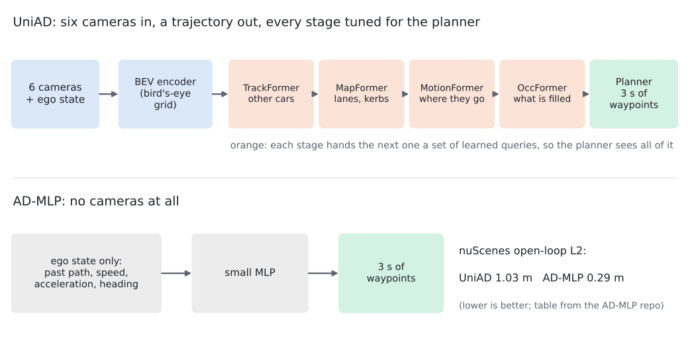
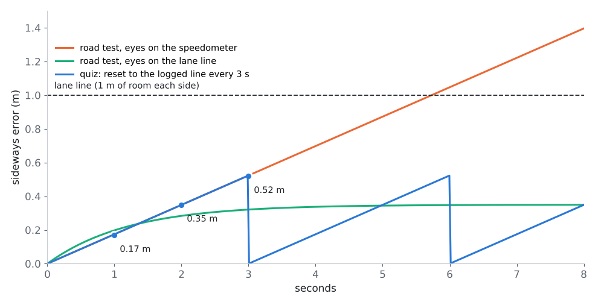
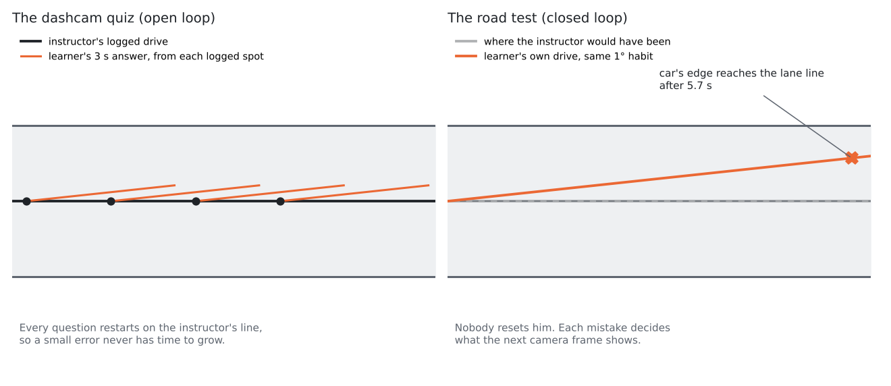
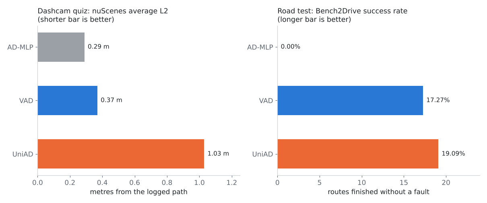
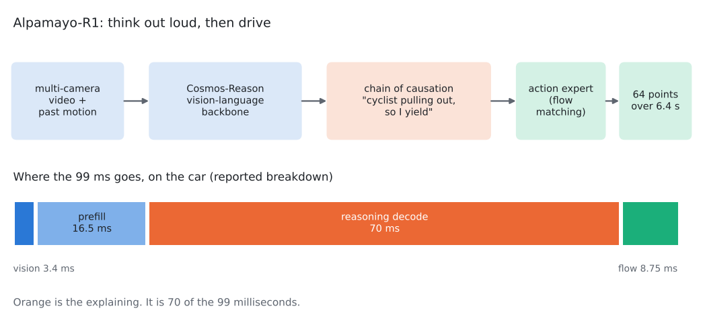

*On the cover: the floor of a driving-school car, with one extra brake pedal on the passenger side. Placeholder drawn by the author, because Wikimedia Commons could not be reached from the machine this was written on. Source: Author*

In 2023 a driving model called UniAD won the best paper award at CVPR, the biggest computer vision conference of the year. It reads six cameras, finds the cars and lanes, predicts where everybody is going, and plans its own path, all in one network. That same year, a team at Baidu beat it on the same benchmark with a small MLP (a plain stack of fully connected layers) that never looks at a single camera frame. Its planned paths landed more than three times closer to what the human driver actually did.

The [VLA post](/blog/vla-pixels-to-tokens/) said in one line that driving had moved to "closed-loop benchmarks" because the old metric "turned out to be gameable". This post is that line, written out properly.

Welcome to the era of **end-to-end driving**. This is the story of how you grade a network that takes in photons and puts out a steering plan, and of why the grade depends on who is allowed to touch the brake.

## Photon in, control out

A self-driving car used to be a pipeline of separate programs: find the objects, predict where they move, plan a path, steer. **End-to-end** means you replace the pipeline with one network trained on one goal: camera pixels go in, and the car's future path comes out.

The car itself is the **ego** vehicle, so "ego status" means the car's own speed, acceleration, heading and recent path. I want you to remember that word, because it does a lot of damage later.

Now think about a motor driving school in any Indian town. It has a white Maruti Alto with a big red **L** board on the roof, and an instructor in the passenger seat who has taught four thousand people to drive. The car has one modification. There is a second brake pedal on his side of the floor (for an intervention, in the field's word), and his right foot never moves far from it.

He has two ways of finding out whether a learner is ready.

## The dashcam quiz

The cheap way does not need the car. He plays dashcam footage of his own drives, with the speedometer printed in the corner, pauses it, and asks: "From here, where would you steer for the next three seconds?" The learner draws a path. He writes down how far it is from what he actually did that day, skips ahead, and asks again.

That quiz is **open-loop evaluation**. "Open loop" means the learner's answer never goes back into the world. Whatever he draws, the next question starts from wherever the instructor really was.

The benchmark everybody used for this was [nuScenes](https://www.nuscenes.org/), a dataset of a thousand 20-second drives recorded in Boston and Singapore with six cameras and a laser scanner (LiDAR) on the roof. The score is the **L2 error**: the straight-line distance between the planned point and the logged point, at 1, 2 and 3 seconds into the future.

Formally,

$$\text{L2}(t) = \frac{1}{N}\sum_{i=1}^{N} \big\Vert \hat{p}_i(t) - p_i(t) \big\Vert_2$$

where $N$ is the number of paused clips, $\hat{p}_i(t)$ is the model's predicted position $t$ seconds after clip $i$, and $p_i(t)$ is where the recorded car really was. Papers average $t = 1, 2, 3$ seconds into one number in metres, next to a collision rate: how often the planned path runs through a box another car occupied in the recording.

It is a lovely test. Nobody can get hurt, and you can score the whole dataset over lunch.

## The learner who watched the speedometer

Here is what went wrong with it.

Most of those 20-second clips are a car going roughly straight at a roughly constant speed. So a learner who ignores the windscreen, looks at the speedometer in the corner and says "keep doing what you were doing", is right most of the time. He will be wrong at the turn, but the quiz is mostly not turns.

[AD-MLP](https://arxiv.org/abs/2305.10430) (Zhai et al., Baidu, 2023) is that learner. It is a small multi-layer perceptron that reads only the ego status (past path, speed, acceleration, heading) and outputs the next three seconds. Here is how it did against the camera-based models, from the table in the [AD-MLP repository](https://github.com/E2E-AD/AD-MLP). The other rows were all scored the same way, by the [VAD](https://arxiv.org/abs/2303.12077) authors; lower is better in both columns:

| Model | Looks at the road? | Avg L2 (m) | Avg collision (%) |
|---|---|---|---|
| UniAD | yes, six cameras | 1.03 | 0.31 |
| VAD-Base | yes, six cameras | 0.37 | 0.14 |
| AD-MLP | no | 0.29 | 0.19 |

Twenty-nine centimetres, about the length of a school ruler, from a model that has never seen a road. It loses on collisions to VAD because it cannot see other cars. But on the headline number it wins.

 *Figure 1: what each model gets to read. [UniAD](https://arxiv.org/abs/2212.10156) passes learned queries down a chain of stages to its planner. AD-MLP only gets the numbers in the corner of the dashcam frame. Source: Author*

The follow-up made it worse. [Is Ego Status All You Need for Open-Loop End-to-End Autonomous Driving?](https://arxiv.org/abs/2312.03031) (Li et al., NVIDIA, CVPR 2024) built a deliberately simple camera planner, BEV-Planner, and ran it twice. Without ego status it scored an average L2 of 0.55 m and a collision rate of 0.59%. Give it the speedometer and it dropped to 0.35 m and 0.34%. Their conclusion was that camera models on this benchmark lean heavily on ego status, and they asked the community, quite politely, to stop trusting it.

If you think about it, this is not a bug in any one model. A planner trained to match the logged path will use whatever predicts the logged path best. On a dataset of mostly straight roads, the speedometer predicts it better than six cameras do, and gradient descent is not sentimental about cameras that cost a lot of money.

## Why the quiz can't see it

So why doesn't the quiz notice that the speedometer-reader cannot actually drive? Because the quiz never lets his mistakes add up.

Let's do one by hand. Say the learner has a tiny habit: he always steers one degree to the left of where he should. The car is doing 10 m/s (36 km/h, normal for a town road). Sideways, one degree at 10 m/s is $10 \times \sin(1°) \approx 0.175$ metres every second.

On the dashcam quiz, every question starts on the instructor's line. So his error is 0.175 m at one second, 0.35 m at two and 0.52 m at three. That averages to 0.35 m, which is about what VAD scores. On paper he is one of the best drivers in the class.

Now give him the car. A town lane is about 3.5 m wide and an Alto is about 1.5 m wide, so he has roughly a metre of room on each side. Nobody resets him to the centre this time. The error keeps growing at 0.175 m every second, and he touches the lane line after $1.0 / 0.175 \approx 5.7$ seconds. The instructor's foot goes down on the second brake somewhere around second five.

 *Figure 2: the same one-degree habit, graded two ways. The green line is a sketch of a driver who can see the lane and steers back, not a real model. Source: Author*

On the road the learner's own mistake decides what he sees next, and what he sees next decides his next mistake. A model that watches the lane line can notice the drift and steer back (the green line). A model that only reads the speedometer cannot, because the lane line is not one of its inputs. And the quiz cannot tell those two apart.

 *Figure 3: open loop on the left, closed loop on the right. Same learner, same habit, very different afternoon for the instructor. Source: Author*

Imitation learning has known this for a long time. Copying an expert's actions is called **behaviour cloning**. [Ross and Bagnell (2010)](https://proceedings.mlr.press/v9/ross10a.html) looked at a cloned policy that makes a mistake with probability $\epsilon$ on the states the expert visits. They showed that its total cost over a drive of $T$ steps can grow with $T^2$, not with $T$. One mistake puts you somewhere the expert never showed you, where the next mistake is more likely.

Formally,

$$J(\hat{\pi}) \le J(\pi^*) + T^2 \epsilon$$

where $J$ is the total cost of a drive, $\hat{\pi}$ is the learner (the cloned policy), $\pi^*$ is the instructor (the expert), $T$ is the number of decisions and $\epsilon$ is the learner's error rate on the instructor's own clips. Their fix, [DAgger](https://arxiv.org/abs/1011.0686), is exactly what a good instructor does: let the learner drive, and have the expert label what he should have done in the places the learner ended up. That brings the bound down to roughly linear in $T$.

At 10 decisions a second, a 20-second drive is $T = 200$. A learner who fluffs one question in a thousand on the quiz is allowed, by this bound, $200^2 \times 0.001 = 40$ units of cost on the road. It is a worst case, and real models are rarely that unlucky. But it is why the instructor's foot never leaves the pedal.

## The road test

So the honest test is to let go of the car. You put the model in a simulator like [CARLA](https://carla.org/), an open-source town for testing driving software, and the world reacts to what it does. That is **closed-loop evaluation**: the model's output goes back into its own next input.

[Bench2Drive](https://github.com/Thinklab-SJTU/Bench2Drive) (Jia et al., 2024) is the version most end-to-end papers now report. It runs in CARLA 0.9.15. It has 220 short routes built from 44 situations: merging, overtaking, emergency braking, giving way, and reading traffic signs.

Each route gets a **driving score**. In words, it is how far you got, discounted by every fault on the way:

$$\text{driving score} = \text{route completed} \times \text{penalty for each fault, multiplied together}$$

specifically,

$$\text{DS} = R \times \prod_{j} p_j^{\,n_j}$$

where $R$ is the percentage of the route completed (so the score is out of 100), $n_j$ is how many times you committed fault $j$, and $p_j$ is the penalty for that fault. CARLA's penalties are 0.50 for hitting a pedestrian, 0.60 for another vehicle, 0.65 for a static object, 0.70 for running a red light and 0.80 for a stop sign. So by the arithmetic, running two red lights ($0.7 \times 0.7 = 0.49$) costs you slightly more than hitting a pedestrian. I am sure there was a meeting about this, and nobody came out of it happy. **Success rate** is simpler: the share of routes finished with no faults at all.

The same learners on the road, from the Bench2Drive README. Bench2Drive retrained every one of them on its own CARLA data, and the simulator hands AD-MLP its speed and heading:

| Model | Driving score | Success rate (%) | Verdict |
|---|---|---|---|
| AD-MLP | 35.39 | 0.00 | best on the quiz, never once finishes a route cleanly |
| [VAD](https://arxiv.org/abs/2303.12077) | 38.65 | 17.27 | the quiz liked it, the road roughly agrees |
| UniAD | 38.69 | 19.09 | worst of the three on the quiz, level with VAD here |
| [TCP](https://arxiv.org/abs/2206.08129) | 51.44 | 26.36 | copies the simulator's expert driver, including its internal features |

AD-MLP still scores 35 because it gets part of the way along most routes, but zero of its 220 routes are clean. On the quiz it beat UniAD by 0.74 m. On the road, UniAD and VAD finish about one route in six and AD-MLP finishes none. The quiz's winner comes last, and that is the main result of this post.

 *Figure 4: the same three models, quizzed and then driven. The ranking turns upside down. The two tests use different data, so compare the order, not the numbers. Source: Author*

**NOTE:** Bench2Drive's numbers move between versions (the [model zoo](https://github.com/Thinklab-SJTU/Bench2DriveZoo) has UniAD at 45.81 and 16.36%, VAD at 42.35 and 15.00%), but AD-MLP is last in both.

## The rule-follower who wins the road test

In 2023 [nuPlan](https://www.nuplan.org/), a big planning benchmark built from 1,200 hours of real driving logs, ran a challenge with both kinds of test. Dauner et al. entered [PDM-Closed](https://arxiv.org/abs/2306.07962), which is barely learned at all. It follows the lane centreline at a few speeds picked by a textbook car-following rule (IDM, the [Intelligent Driver Model](https://en.wikipedia.org/wiki/Intelligent_driver_model)). It simulates each option forward a few seconds, and keeps the one that scores best on not crashing and making progress.

That is the instructor's own advice written as code: "stay in the middle and keep a gap". On nuPlan's closed-loop score it gets about 93, against about 76 for plain IDM. On the open-loop score it gets about 42 out of 100, which is terrible, because it doesn't try to copy the human, it tries not to crash. A hybrid version, with a small learned model added for the open-loop half, came first out of 25 teams. So it is AD-MLP the other way round: bad at copying the human, good at driving.

## Four seconds of road

A full simulator is slow and renders a cartoon town, so the field built something in between. [NAVSIM](https://github.com/autonomousvision/navsim) (Dauner et al., NeurIPS 2024) takes real camera frames from real drives, lets the model plan four seconds ahead, and then rolls that plan forward against the recording. The other cars do not react (they replay what they did on the day), which is why it is called non-reactive. The instructor lets go for four seconds, then takes the wheel back.

Its score, the **PDM score** (PDMS), multiplies the two things you must never do, and averages the things you should do (reported out of 100):

$$\text{PDMS} = \text{NC} \times \text{DAC} \times \frac{5\,\text{TTC} + 5\,\text{EP} + 2\,\text{C}}{12}$$

where NC is no at-fault collision, DAC is staying on the road, TTC checks the time-to-collision never got too short, EP is ego progress (how far you got compared with a reference planner) and C is comfort. A collision or leaving the road zeroes the whole score, the way the instructor's foot zeroes the lesson.

Does four seconds of road predict the full road test? A May 2026 paper, [Do Open-Loop Metrics Predict Closed-Loop Driving?](https://arxiv.org/abs/2605.00066) (Wang et al.), took every method that had reported both a NAVSIM score and a Bench2Drive score, and checked:

1. The old displacement error (the quiz score) had a rank correlation of $-0.36$ with closed-loop driving score, with a p-value of 0.43. That is weak and could easily be chance.
2. The PDM score had a rank correlation of 0.90, which is strong, but with clear ranking inversions.
3. The best single part of PDMS was ego progress (0.83), well ahead of the collision term. Some methods that played it safe got a good overall PDMS, and then timed out on Bench2Drive for driving too slowly.

So the four-second test is a decent predictor of the road test, and the thing it measures best is whether you actually get on with it. Which is also the first thing a driving instructor shouts from the passenger seat.

## A learner who talks while driving

The newest learners narrate. [Alpamayo-R1](https://arxiv.org/abs/2511.00088) (NVIDIA, 2025) is a 10B vision-language-action model that writes a short **chain of causation** before it plans: "cyclist pulling out on the left, so I slow down and give way". Then an action expert (flow matching, as in the [Flux post](/blog/flux-models-next-gen-image-generation-part2/)) turns that into 64 waypoints over 6.4 seconds.

 *Figure 5: Alpamayo-R1 and its latency budget on the car. Orange is the model explaining itself. Breakdown from secondary write-ups, not the paper. Source: Author*

NVIDIA reports up to 12% better open-loop planning on hard cases than without the reasoning. But the claims they lead with are closed-loop, in their AlpaSim simulator: 35% fewer drives leaving the road and 25% fewer close encounters. They also report road tests in a real car at 99 ms per decision, of which roughly 70 ms is the model writing out its reasons. That closed-loop result comes from the vendor's own simulator, on 75 scenarios, against the vendor's own baseline.

## Where you meet this

- **Most end-to-end papers since 2024** report NAVSIM or Bench2Drive instead of, or next to, nuScenes L2.
- **Driving VLAs** like Waymo's [EMMA](https://arxiv.org/abs/2410.23262) are end-to-end planners too.
- **Anything that acts.** A robot arm and a web agent both have a quiz and a road test (see the [benchmarks post](/blog/llm-benchmarks-terminal-bench/)). Driving got there first, and it has the 0% to prove it.

## Where things are going

NAVSIM v2's [pseudo-simulation](https://github.com/autonomousvision/navsim) adds synthetic views near the model's planned path, so the model sees the road from where it went rather than where the human went. The authors claim it tracks closed-loop results at a sixth of the compute. Rendering that road is the job of a [Gaussian splat](/blog/gaussian-splatting/) or a [world model](/blog/world-models-learned-simulators/).

The other trend is training in closed loop too. Papers like [DIVER](https://arxiv.org/abs/2507.04049) already fine-tune a cloned planner with rewards from the simulator, the way the [GRPO post](/blog/grpo-rlvr/) fine-tuned a language model against an answer key.

## What the second brake pedal doesn't catch

CARLA's town is a cartoon, and its other drivers are scripted to be polite. Nobody in CARLA parks a handcart in the left lane or comes the wrong way down a one-way street at night. And Bench2Drive's top entry (LEAD) is already at 95.59 driving score and 87% success. So the road test may saturate (everyone near full marks, nothing left to rank) before anyone has checked it against real roads.

Then there is the size of the evidence. The correlation study behind the PDM score had paired data for only 8 methods, and one more could move a rank correlation a lot. And its strongest finding, that progress predicts success better than safety, says the road test rewards getting on with it. That is fine for a CARLA route with a timer, and less obviously what you want from a car with a child in the back seat.

The non-reactive middle rung has its own blind spot. In NAVSIM the other cars replay the recording. So if your model creeps forward to signal that it wants to merge, nobody lets it in. Anyone who has merged onto a Bengaluru ring road knows that is most of the job.

And the real closed-loop test, a car on a public road with a safety driver's foot over a second brake, is what nobody publishes in a comparable form. Companies report miles per intervention from their own fleets. Alpamayo-R1's road tests are described, and not scored against anyone else's. So the test with real traffic in it has no leaderboard at all.

## Conclusion

The dashcam quiz asked a fair question, and in 2023 one of the best answers came from a network with no eyes. It read the speedometer on a dataset of mostly straight roads, and nobody ever let its mistakes add up.

The fix is old and obvious to anyone who has taught a teenager to drive: let go of the wheel and watch. Bench2Drive does it in a simulator and NAVSIM does it for four seconds of real footage, and the quiz's favourite drops to last the moment you do. And in 2023, on nuPlan, a centreline-follower running a car-following rule from 2000 beat every learned planner on the road test.

My bet is that the next two years of driving papers are about the simulator more than the model. Whoever renders the most believable road from where the learner ended up, gets to run the test that counts.

Until then, the instructor stays in the passenger seat with the L board on the roof and his foot an inch from the second brake. He'll move it the day a model passes the road test in his own town, autorickshaws included.

And now you know. Fin.
